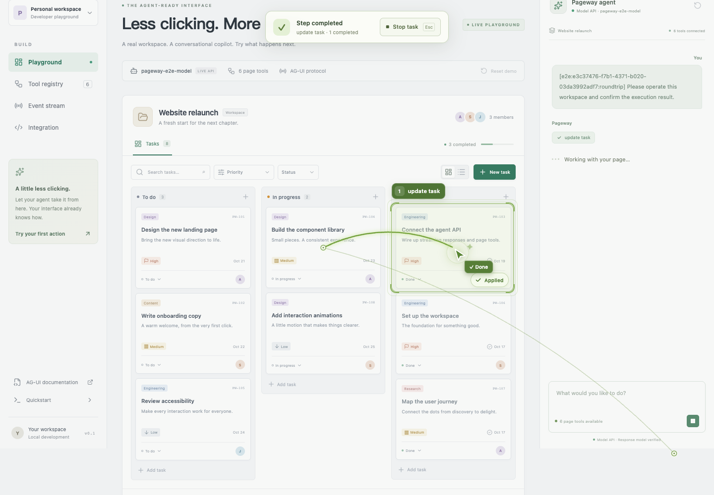
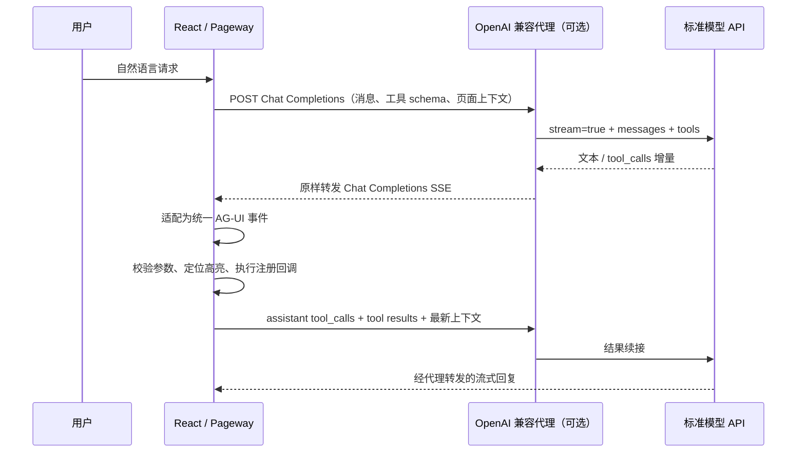

# Pageway · 页径

**让已有 React 页面成为 Agent 可以理解、操作、解释的界面。**

Pageway 将应用显式注册的页面上下文、类型化操作工具、聊天 UI 和操作轨迹连起来。前端指定 OpenAI 兼容 API 地址，浏览器负责对话循环、执行回调和结果续传；后端只需提供标准模型接口或凭证代理。同一套工具也可通过浏览器 WebMCP 交给其他 Agent 调用。

基于 pnpm workspace、Vite、TypeScript 和 AG-UI 的 MIT 开源项目。三个 SDK 使用 `@zllling/pageway-*` 包名：protocol、agent、react。

[](https://github.com/ForXd/pageway/actions/workflows/ci.yml)
[](https://github.com/ForXd/pageway/actions/workflows/pages.yml)

[在线文档](https://forxd.github.io/pageway/) · [在线演示](https://forxd.github.io/pageway/demo/) · [接入文档](packages/react/README.md) · [测试流程](docs/testing.md) · [浏览器测试](docs/testing-e2e.md) · [发布说明](docs/releasing.md)



截图来自本地 HTTP 模型 fixture 的浏览器 E2E，展示实际页面修改、操作路径和完成反馈。

## 在线体验与文档

打开 [Pageway 文档站](https://forxd.github.io/pageway/)，查看可复制的 React、模型代理、会话缓存与 WebMCP 接入示例。[独立演示](https://forxd.github.io/pageway/demo/) 可以直接体验筛选、更新任务、切换视图、执行动画、页面锁定与取消。

在线演示在浏览器内运行确定性规划器，无需 API Key；它复用实际 SDK、SSE 编解码和工具结果续接，不调用真实模型，也不保存任务数据。真实模型可接已有 OpenAI 兼容网关或单独部署凭证代理，模型密钥保留在服务端。

```sh
pnpm dev:site       # 本地文档与演示站
pnpm build:site     # 构建至 apps/site/dist
pnpm preview:site   # 预览 /pageway/ 子路径
pnpm test:site      # 对生产构建执行站点与演示 E2E（先 build:site）
```

`main` 更新经构建与站点浏览器测试后自动发布至 GitHub Pages，配置见 [站点部署](docs/github-pages.md)。

## 快速启动

需要 Node.js **22.14+** 和 pnpm **12.14.0**。依赖版本于 2026-10-17 从 registry 核验：Vite **8.3.4**、TypeScript **7.0.2**、React **19.3.1**、AG-UI **1.0.3**。锁文件固定安装解析。仓库演示应用使用 React 19；React SDK 同时支持 **React 18 和 19**。

```sh
corepack enable pnpm
pnpm install
pnpm dev
```

打开 `http://127.0.0.1:5173`。Agent 服务在 `http://127.0.0.1:3001`，Vite 代理 `/api`。默认 `demo` 模式，无需 `.env`、API Key 或模型服务；界面会明确标注这是确定性演示规划器。

可在聊天框尝试：

- `Show high priority tasks and switch to list view`
- `将 PW-103 标记为完成`
- `创建任务“准备发布说明”，高优先级`
- `总结当前页面`
- `清除筛选`

也可直接操作看板，Agent 下一轮会读取最新应用状态。AI 任务从开始到结束会锁定页面的鼠标与键盘操作，只保留浮层的 Stop task 按钮（或 Esc）用于终止。工具执行时，Agent 光标从聊天框移动到目标，显示聚焦边框、点击脉冲、逐步绘制的 Bézier 路径、步骤编号和完成反馈；操作路径保留参数、结果、耗时与失败详情。事件面板显示实际 AG-UI 流。

端口被占用时，不必停止其他程序：

```sh
PLAYGROUND_PORT=5174 ALLOWED_ORIGINS=http://localhost:5174,http://127.0.0.1:5174 pnpm dev
```

`PLAYGROUND_PORT` 是 Vite 进程环境变量；`PORT` 是 Agent 端口（修改它时设置 `AGENT_PROXY_TARGET=http://127.0.0.1:<PORT>`）。`pnpm dev` 先构建 SDK，再启动两个应用。开发模式直接读取包源码，支持热更新。生产预览可先运行 `pnpm build`，启动 `pnpm --filter @zllling/pageway-server start`，再用支持 `/api` 反向代理的 Web 服务托管 `apps/playground/dist`。

## 项目结构

| 目录 / 包                                         | 职责                                                                |
| ------------------------------------------------- | ------------------------------------------------------------------- |
| `packages/protocol` · `@zllling/pageway-protocol` | AG-UI 官方类型与运行时 schema、SSE 编解码、页面上下文类型           |
| `packages/react` · `@zllling/pageway-react`       | 前端对话循环、注册 hooks、聊天缓存、WebMCP、工具执行与动画轨迹      |
| `packages/agent` · `@zllling/pageway-agent`       | 可选 OpenAI 凭证代理、兼容 AG-UI handler、模型 SSE 适配、演示规划器 |
| `apps/server` · `@zllling/pageway-server`         | Node HTTP 适配、环境配置、健康检查、CORS                            |
| `apps/playground` · `@zllling/pageway-playground` | 已接入 SDK 的 React/Vite 任务看板                                   |
| `apps/site` · `@zllling/pageway-site`             | GitHub Pages 在线文档与浏览器内交互演示                             |

## 在已有 React 应用中接入

三个 SDK 已发布到 npm：[@zllling/pageway-react](https://www.npmjs.com/package/@zllling/pageway-react)、[@zllling/pageway-agent](https://www.npmjs.com/package/@zllling/pageway-agent)、[@zllling/pageway-protocol](https://www.npmjs.com/package/@zllling/pageway-protocol)。

从 **0.1.3** 起，React SDK 支持 `react` / `react-dom` **`^18.0.0 || ^19.0.0`**。两者应使用相同版本，TypeScript 项目使用对应主版本的 `@types/react` 和 `@types/react-dom`。React 18 应用使用 `react-dom/client` 的 `createRoot` 挂载，下面的接入方式在 React 18 和 19 中一致。

```sh
# 在 React 应用中安装
pnpm add @zllling/pageway-react
# 可选：需要自建模型凭证代理时安装
pnpm add @zllling/pageway-agent
```

本仓库内使用 `workspace:*`。测试尚未发布的新版本 tarball 时，三个包需要一起安装，或把内部依赖通过 `pnpm.overrides` 指向本地 tarball；`check:pack` 自动完成独立消费者验证。

```tsx
import { useState } from 'react';
import {
  PagewayProvider,
  PagewayChat,
  PagewayOverlay,
  ActionTimeline,
  usePageContext,
  usePageTool,
} from '@zllling/pageway-react';
import '@zllling/pageway-react/styles.css';

function AgentReadyApp() {
  return (
    <PagewayProvider
      apiOrigin="/api/openai"
      model="your-tool-capable-model"
      storageKey="my-app:current-user:pageway"
      timeoutMs={180_000}
    >
      <YourPage />
      <PagewayChat suggestions={['把排序切换为价格从低到高']} />
      <ActionTimeline />
      <PagewayOverlay />
    </PagewayProvider>
  );
}

function YourPage() {
  const [sort, setSort] = useState('default');

  usePageContext({
    id: 'products',
    title: '商品列表',
    description: '用户当前正在查看的商品排序设置',
    data: { sort }, // 只提供需要模型理解的业务状态
  });

  usePageTool<{ sort: 'default' | 'price_asc' }>({
    name: 'set_sort',
    description: '切换商品排序方式',
    parameters: {
      type: 'object',
      properties: { sort: { type: 'string', enum: ['default', 'price_asc'] } },
      required: ['sort'],
      additionalProperties: false,
    },
    target: '#product-sort', // 可选：selector 或 (args) => HTMLElement | null
    execute: ({ sort }) => {
      setSort(sort);
      return { sort };
    },
  });

  return (
    <select id="product-sort" value={sort} onChange={(e) => setSort(e.target.value)}>
      <option value="default">默认排序</option>
      <option value="price_asc">价格从低到高</option>
    </select>
  );
}
```

`apiOrigin` 接受同源路径或绝对 API 根地址，默认追加 `chat/completions`，可用 `apiPath` 指定其他路径。`model` 是代理允许的模型名。每轮请求发送标准 `messages`、`tools`、`stream: true`，工具结果以 `role: "tool"` 继续发送；后端不需要理解 Pageway 专属请求体。已有 AG-UI 服务继续使用 `endpoint="/api/agent"`，不要同时传入 `apiOrigin`。

`usePageway()` 可用于定制 UI，提供 `messages`、`sendMessage`、`stop`、`reset`、`status`、`error`、`actions`、`events`、`tools` 和 `webmcp`。Provider 的 `headers` 用于应用鉴权，`animationDuration` 控制移动时长；模型 API Key 保留在服务端。`timeoutMs` 控制 apiOrigin 模式每轮模型请求超时，默认 180000 毫秒，范围 1–300000 毫秒；AG-UI endpoint 模式由服务端控制模型超时。

`PagewayOverlay` 默认通过原生 modal dialog 锁定整个页面，正常结束、失败、取消或卸载时恢复交互与焦点。若宿主已实现自己的无障碍锁，可传 `lockPage={false}`。动画遵循系统减少动态效果偏好；`animationDuration={0}` 可关闭移动动画（保留简短的状态反馈）。

工具回调支持同步/异步返回值及第二个 `{ signal }` 参数。异步业务请求应传递该 AbortSignal；停止按钮不能撤销已完成的业务修改，也不能自动取消忽略 signal 的外部副作用。工具动态卸载后不能再执行。浏览器在执行前校验 JSON Schema；后端业务 API 仍负责业务权限。

## OpenAI 兼容凭证代理

如果已有兼容服务，直接设置前端 `apiOrigin` 即可。需要隐藏供应商密钥时，可选用下列代理；它透传标准模型请求及 SSE 响应，不执行 Agent 逻辑。

```ts
import { createOpenAIProxyHandler } from '@zllling/pageway-agent';

// 挂载到 POST /api/openai/chat/completions；接入应用已有的鉴权中间件。
export const POST = createOpenAIProxyHandler({
  baseURL: process.env.MODEL_BASE_URL!,
  apiKey: process.env.MODEL_API_KEY,
  allowedModels: [process.env.MODEL_NAME!],
  timeoutMs: 180_000,
});
```

上游地址由服务端固定，浏览器不能指定转发目的地。代理不透传客户端 Authorization，而是使用服务端配置的模型密钥；支持模型白名单、请求体上限、超时与取消。普通 OpenAI 网关也可替换这个 handler，React 应用无需改动。

## 兼容已有 AG-UI Agent 服务

```ts
import { createAgentHandler } from '@zllling/pageway-agent';

const handleAgent = createAgentHandler({
  mode: 'openai',
  baseURL: process.env.MODEL_BASE_URL!,
  apiKey: process.env.MODEL_API_KEY, // 本地或允许匿名的服务可省略
  model: process.env.MODEL_NAME!,
  timeoutMs: 180_000, // 免费模型可能需要较长排队时间
  systemPrompt: '帮助用户整理当前项目，修改前核对任务编号。',
});

// 在框架中把 POST /api/agent 的标准 Request 交给 handler。
// 返回标准 Response，body 是 text/event-stream。
export const POST = handleAgent;
```

`createAgentHandler()` 默认使用演示规划器。它只识别 playground 工具和有限指令；接入自己的工具时使用 `mode: 'openai'`。Agent 包不依赖 Express，支持提供 Fetch Request/Response 的服务端环境。Node 示例在 `apps/server`。

真实模型配置：

```sh
cp .env.example .env
# 示例已配置 Kilo 免费匿名模型，无需 API Key；也可替换为自己的兼容 API
pnpm check:model
pnpm dev
```

`check:model` 用合成数据检查普通文本、函数调用和工具结果续答；工具结果携带现场生成的随机回执，最后的回复必须包含回执才算通过，失败会非零退出。实际 Agent 适配器还会验证流式 Chat Completions；它不直接支持 Responses、Anthropic Messages 或 Gemini 原生协议。

**Kilo Gateway 免费匿名模型已验证真实 SSE 工具调用与结果续答**，模型为 `nvidia/nemotron-3.5-lightning:free`。默认示例使用官方地址 `https://ai-gateway.kilo.ai/api/v1`，无需 API Key，超时设置为 180 秒。免费服务响应可能较慢；界面显示服务商实际返回的模型名。OpenCode 免费层当前拒绝外部请求（403），不作为示例默认值。详情见 [模型配置](docs/providers.md) 与 [验证记录](docs/verification.md)。

## 协议与执行过程



每轮在引擎内表示为 `RUN_STARTED` → 文本/工具事件 → `RUN_FINISHED` 或 `RUN_ERROR`。前端等成功的 run 结束后才执行完整接收的工具，按顺序执行并开启下一轮；最多 12 轮。`apiOrigin` 模式在线上传输标准 Chat Completions；`endpoint` 模式继续在线上传输 AG-UI `RunAgentInput` / SSE。两者共用引擎和工具执行器，均无需独立的结果上报端点。详细字段见 [通信协议](docs/protocol.md)。

页面理解来自应用注册的业务上下文，不会扫描整个 DOM 或执行任意模型生成代码。若需要让 Agent 操作另一页面，在新页面注册上下文及工具。视觉 target 只负责定位，不参与工具授权。

## 本机会话缓存

传入 `storageKey` 后，对话与操作轨迹会在任务结束、页面离开、Provider 卸载或切换 key 时保存到 `localStorage`；默认不缓存。建议按用户和工作区隔离，例如 `my-app:${userId}:${workspaceId}:pageway`。切换 key 会切换会话，`usePageway().reset()` 清空当前消息、轨迹及缓存；退出登录时也应清理。

缓存有效期 7 天，每条上限 1 MiB。存储不可用、损坏、过期或超额时不会阻断页面。恢复不执行历史工具、不恢复页面业务状态或动画与交互锁，也不会自动续跑刷新前的任务。缓存包含消息与工具参数、结果，为当前浏览器同源可读的明文数据；按应用的数据策略启用。详见 [React SDK](packages/react/README.md)。

## 无 Agent 后端的 WebMCP 接入

```tsx
<PagewayProvider webmcp={{ prefix: 'shop_' }}>
  <YourPage /> {/* 同一套 usePageTool / usePageContext */}
  <ActionTimeline />
  <PagewayOverlay />
</PagewayProvider>
```

不传 `apiOrigin` 或 `endpoint` 即可只暴露页面工具，不渲染内置聊天。WebMCP 默认开启，默认工具名为 `pageway_<原工具名>`，另有 `pageway_get_context` 返回最新注册上下文。可设 `webmcp={false}` 关闭。外部调用经过同一执行器，具有参数校验、动画、轨迹、锁定与取消能力；并发任务不会覆盖正在进行的任务。

`usePageway().webmcp` 提供 `status`、`registered` 和 `error`。当前优先注册到 `document.modelContext`，兼容早期 `navigator.modelContext`。浏览器与调用方必须支持 WebMCP；没有原生 API 时显示 `unsupported`，不安装伪 polyfill。Chrome 本地测试需启用 `chrome://flags/#enable-webmcp-testing`，公开站点遵循浏览器实验开放条件。[当前规范](https://webmachinelearning.github.io/webmcp/) · [Chrome 官方说明](https://developer.chrome.com/docs/ai/webmcp/imperative-api)

[打开 WebMCP-only 演示](https://forxd.github.io/pageway/webmcp/)：没有聊天后端或模型请求，保留任务页面、操作轨迹与锁定浮层；当前浏览器不支持时会显示不可用状态。

集成前可让开发助手读取仓库内 [React 接入 Skill](skills/integrate-pageway/SKILL.md)，按现有应用结构注册窄范围工具与上下文。

## 检查与边界

```sh
pnpm check             # lint、格式、类型、单测覆盖率、生产构建
pnpm exec playwright install --with-deps --no-shell chromium firefox webkit
pnpm test:e2e          # 完整浏览器链路，使用本地模型 HTTP fixture
pnpm check:pack        # React 18/19 独立消费者安装、SSR、客户端生命周期、类型
pnpm test:site        # 生产文档站与浏览器内演示 E2E（先 build:site）
pnpm check:all         # 上述完整门禁，包含站点 E2E
pnpm release:dry-run   # 发布预检与 npm dry-run，不上传
pnpm check:model       # 可选：真实外部模型 API，不在普通 CI 消耗额度
pnpm check:model:frontend # 固定匿名免费模型，验证前端循环→HTTP代理→工具结果续答
```

本次运行结果见 [验证记录](docs/verification.md)。

测试覆盖 SSE 字节边界与 UTF-8、AG-UI schema/lifecycle、真实本地 HTTP 模型 fixture、连续工具回传、错误脱敏、超时/取消、未知工具与参数拒绝、重复调用、中断恢复、最新回调和页面状态读取。Playwright 覆盖 Chromium、Firefox、WebKit 和移动 Chromium，实际执行页面工具并核对模型收到的结果与最新页面状态；逐帧检查动画、交互锁和 reduced motion。

GitHub Actions 在 Node 24/26 执行质量门禁，并上传覆盖率、浏览器报告及已验证 tarball。独立消费者验证覆盖 React 18.0.0、18.2.0、18.3.1 和 19.3.1，检查打包后的 SDK 在各版本中的安装、类型、SSR 与客户端生命周期。`v*` 标签触发同样的完整检查，再通过 npm OIDC 按依赖顺序发布三个包；首次认证与 trusted publisher 配置见 [发布说明](docs/releasing.md)。

这是开发者预览，不包含会话数据库、多用户身份系统、持久审计、限流、审批策略或工具业务权限。应用需沿用自己的登录与业务授权；示例服务默认监听 loopback 并限制 CORS。公开部署时在 handler 外接入认证、配额与业务权限。CORS 不是授权。上下文和工具结果属于客户端输入，不能作为后端权限依据。

构建产物在各包 `dist/`，CSS 通过 `@zllling/pageway-react/styles.css` 引入。包使用 ES modules；React 和 React DOM 由应用提供，支持 18 和 19。

## 参与贡献

请先阅读 [贡献指南](CONTRIBUTING.md)。漏洞报告使用 [私密安全报告](https://github.com/ForXd/pageway/security/advisories/new)。本项目采用 [MIT License](LICENSE)。
