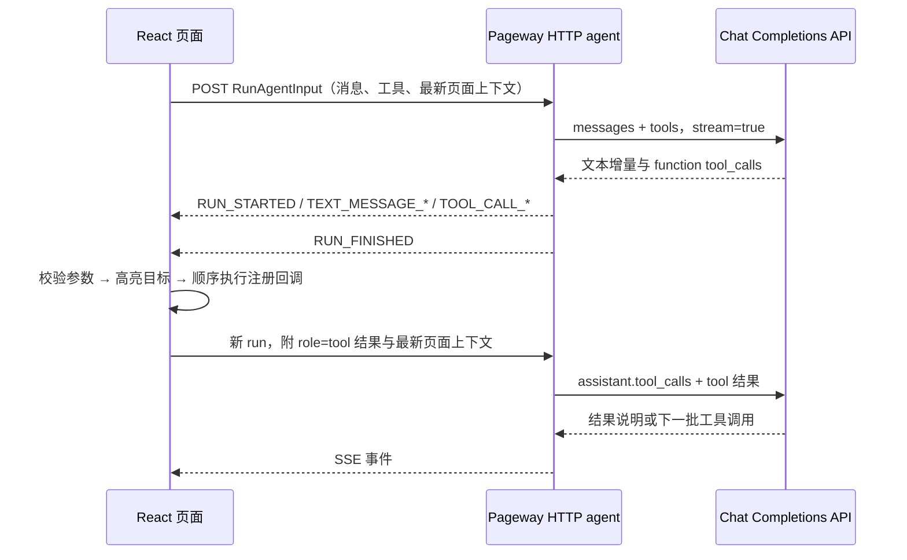

# Pageway 的模型接口与执行协议

Pageway 0.2 把 Agent 循环放在浏览器。前端可直接指定 OpenAI 兼容 API 根地址；后端只需透传标准模型请求。原有 AG-UI HTTP 接入继续支持。两条路径共用前端工具执行器和内部事件，因此动画、取消与结果续传的语义一致。

`@zllling/pageway-protocol` 导出 `@ag-ui/core@1.0.3` 类型与官方 schema，并提供 SSE 编解码；内部使用文本、工具调用和 run 生命周期事件。[AG-UI 官方事件说明](https://docs.ag-ui.com/concepts/events)

## 三种接入边界

| 前端配置              | 页面外部的协议                                                                    | Agent 循环与结果回传                                                          |
| --------------------- | --------------------------------------------------------------------------------- | ----------------------------------------------------------------------------- |
| `apiOrigin` + `model` | OpenAI Chat Completions 请求及 SSE；默认追加 `chat/completions`，可配置 `apiPath` | React SDK 在浏览器适配事件、执行工具，再发送包含结果和最新上下文的模型请求    |
| `endpoint`            | `RunAgentInput` + AG-UI SSE                                                       | 保留已有 Agent 服务；浏览器执行工具并向下一轮提交结果                         |
| 仅 `webmcp`           | 浏览器原生 WebMCP API                                                             | 外部浏览器 Agent 调用工具，执行结果直接通过 WebMCP 返回，不发起模型 HTTP 请求 |

`apiOrigin` 和 `endpoint` 互斥。不配置任何模型端点时仍可注册 WebMCP 工具，但无法使用内置模型聊天。`createOpenAIProxyHandler` 是可选凭证边界：接收标准 Chat Completions 请求，固定上游、验证允许的模型、使用服务端密钥并流式转发响应。它不读取 Pageway 的 run ID、不执行工具、也不保存会话。

apiOrigin 每轮会在浏览器把注册上下文加入模型消息，将工具定义转换为标准 function tools。模型完成一轮后，前端才执行工具；后续请求包含 `assistant.tool_calls`、匹配的 `tool_call_id` 结果及最新页面上下文。数据线上没有 Pageway 专属 envelope。Provider `timeoutMs` 默认 180000 毫秒，限制为 1–300000；代理超时单独配置。

## 兼容 AG-UI HTTP 的一次请求

一个 HTTP 请求对应一个 run。同一段对话沿用 `threadId`，每轮 POST 生成新的 `runId`。前端最多自动进行 12 轮；同一 provider 的工具调用列表按接收顺序执行。后端无会话存储，前端每轮提交完整历史。以下 HTTP 字段仅适用于 `endpoint` 模式；apiOrigin 模式在浏览器内部适配成同样的事件。

## HTTP 输入

`POST /api/agent`，`Content-Type: application/json`，响应为 `text/event-stream`。请求体采用官方 `RunAgentInput`：

| 字段                 | 当前 Pageway 用法                                                                       |
| -------------------- | --------------------------------------------------------------------------------------- |
| `threadId` / `runId` | 对话与本轮请求标识，前端检查响应标识是否匹配                                            |
| `messages`           | `user`、`assistant`、`tool` 文本历史；工具调用保存在 `assistant.toolCalls`              |
| `tools`              | 已注册能力的 `name`、`description`、JSON Schema `parameters`；不发送执行函数或 DOM 引用 |
| `context`            | 每个页面上下文转换为 `{ description, value }`，`value` 是 `{ id, data }` 的 JSON 字符串 |
| `state`              | `{ page: PageContext[] }`，每次请求重新读取                                             |
| `forwardedProps`     | 当前仅标识来源 `@zllling/pageway-react`                                                 |

模型适配器将 `toolCalls` 映射为 OpenAI 的 `tool_calls`，将 `toolCallId` 映射为 `tool_call_id`。模型收到的是应用显式注册的数据；不会自动抓取 DOM、截图、浏览器 Cookie 或未注册控件。

## SSE 输出与执行时机

每帧格式为 `data: <JSON>\n\n`。协议包会处理 UTF-8 分块、CR/LF、注释与多行 data，并使用官方 `EventSchema` 校验事件。

| 事件                             | 页面端行为                                                         |
| -------------------------------- | ------------------------------------------------------------------ |
| `RUN_STARTED`                    | 校验当前对话与 run 标识                                            |
| `TEXT_MESSAGE_START/CONTENT/END` | 建立并增量更新 assistant 文本                                      |
| `TOOL_CALL_START`                | 记录调用 ID、工具名、关联的 assistant 消息，操作路径显示 planning  |
| `TOOL_CALL_ARGS`                 | 按调用 ID 拼接 JSON 字符串；完整前不会执行                         |
| `TOOL_CALL_END`                  | 标识参数流完整                                                     |
| `RUN_FINISHED`                   | 仅当本轮所有工具参数流完整后，开始前端执行                         |
| `CUSTOM` / `pageway.provider`    | 记录请求模型、实际响应模型、服务商及免费池回退信息；仅作为诊断信息 |
| `RUN_ERROR`                      | 停止本轮，将待处理调用记录为失败                                   |

工具执行由浏览器中注册的 `execute(args, { signal })` 完成。结果存为 `role: "tool"` 消息，`content` 为 `{ ok: true, result }` 或 `{ ok: false, error }` 的 JSON。随后发起新 run，由模型根据实际结果续答。当前后端不发送 `TOOL_CALL_RESULT`；本地操作路径由引擎执行状态驱动，不是服务端推测的成功状态。

AG-UI handler 和浏览器执行器都会校验 JSON Schema；普通 OpenAI 代理只处理模型 HTTP 边界，实际参数校验由浏览器执行器负责。模型仅提出调用；未注册工具或非法参数不会执行。运行时 `target` 只用于滚动、高亮与连线，不决定业务操作。目标 DOM 不存在时，注册工具仍可执行。

## 错误、取消与边界

- 停止会中断 HTTP 流、动画和待执行工具，并向正在运行的工具传递 `AbortSignal`。应用的异步工具必须检查或转交这个 signal；已完成的业务操作不会自动回滚。
- 流中断时不会把半截参数作为成功调用。残缺历史参数被规范化为有效对象，并配对明确的失败结果，让下一轮对话可以恢复；原始事件仍可检查。
- AG-UI handler 请求体上限 1 MiB、消息最多 256 条、工具最多 64 个；服务端模型请求默认 45 秒，可配置。apiOrigin 的前端模型请求默认 180 秒。客户端单工具参数上限 200 KB，事件日志保留最近 250 个事件。可选 localStorage 缓存不做历史摘要，长会话仍应重新开始。
- OpenAI 模式要求 provider 返回 SSE、标准结束原因与 `[DONE]`。网络错误、未知工具、非法参数、截断输出都会产生 `RUN_ERROR`，不会产生可执行的成功完成信号。
- 对部分兼容推理模型，`reasoning_content` 通过 `metadata.pageway.reasoning_content` 原样带回后续请求，不作为聊天正文。该字段是明文续传数据，不是加密存储；调试事件中可能包含它。

Pageway 当前未实现完整 AG-UI 功能面：不会应用 `STATE_DELTA`、`STATE_SNAPSHOT`、消息快照或快捷 chunk 事件，也不包含人审中断、子 agent 编排、二进制内容与断线重放。外部 agent 对接应发送上表中的完整生命周期事件；页面动作的显式注册与结果回传方式与 AG-UI 的前端工具模型一致。[AG-UI 工具概念](https://docs.ag-ui.com/concepts/tools)

## 模型来源事件

真实模型模式在上游连接后发送标准 AG-UI `CUSTOM` 事件，`name` 为 `pageway.provider`。`value` 包含 `requestedModel`、`model`（尚未知时为 null）、`provider`（URL host）和 `modelSource`（`unknown`、`header`、`response`）。若上游提供相关响应头，还可能包含 `fallback`、`freeModel`、`originalModel`、`fallbackModel`。收到 SSE 的实际 `model` 字段后会更新事件；UI 使用最近的实际模型名称。只透传经过长度/控制字符/已知密钥过滤的模型标识，不透传任意响应头。

免费网关有时在结束后追加相同 `finish_reason` 的空 delta 帧。适配器允许这种无内容尾帧，仍拒绝结束后的新增文本或工具参数。

## WebMCP 与恢复边界

WebMCP 默认注册 `pageway_<tool>` 和只读 `pageway_get_context`；自定义 prefix 会同时应用到两者。优先调用当前规范的 `document.modelContext.registerTool(tool, { signal })`，通过注册信号清理工具；早期 navigator API 使用逐个 unregister。注册失败不会清空浏览器中的其他工具。

执行时读取最新回调，通过与聊天共享的校验、动画、轨迹和取消流程运行。Native 返回 JSON `{ ok: true, result }` 或 `{ ok: false, error }`；navigator 兼容适配器返回包含该 JSON 的 MCP text content。更新 metadata/schema 不会中止已经开始的调用；真正移除工具、卸载 Provider 或调用方取消则中止对应在途任务。

localStorage 由 `storageKey` 显式开启，在任务结束、页面离开、Provider 卸载或切换 key 时保存对话 ID、消息与轨迹，不保存模型凭证、注册回调或页面业务状态。缓存七天过期、最多 1 MiB；无效缓存被忽略。恢复时任何未配对的工具调用变成失败回执、进行中的轨迹变成取消，历史调用不会重放。缓存不会恢复执行中的网络连接、页面锁或动画。
